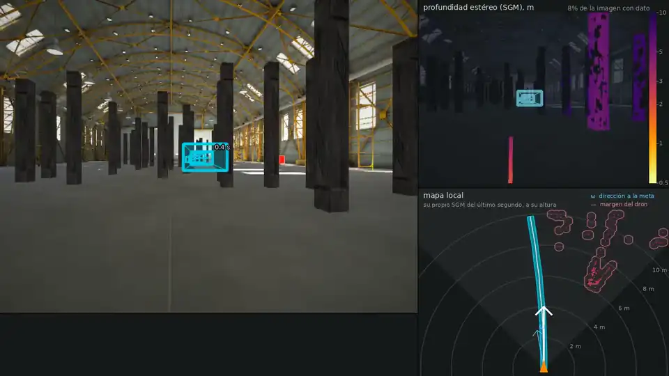

# tinyuav

Vuelo rápido entre obstáculos y seguimiento de objetivos con estéreo a bordo y políticas pequeñas
entrenadas por física diferenciable. Evaluación en lazo cerrado en un simulador propio y en Flightmare (Unity).

<p align="center">
  <a href="assets/flightmare_warehouse_10ms.mp4">
    
  </a>
</p>

## Método

- **Percepción.** Par estéreo de 320 × 240, base de 0.1 m y ~90° de campo; profundidad por SGM con filtros
  de textura y de bordes. La red recibe profundidad inversa de 16 × 12: el píxel válido más cercano de cada bloque.
- **Navegación.** CNN de tres capas y GRU, 391 k parámetros, salida en aceleración. Entrenada por gradiente a
  través de un simulador de masa puntual diferenciable (Δt = 1/15 s, 150 pasos, lotes de 64 bosques de
  Poisson), sin experto ni etiquetas.
- **Seguimiento.** La misma red, ajustada con una barrera de visibilidad entre dron y objetivo; detector de
  color, filtro de Kalman 3D y predicción del giro.

## Instalación

```bash
git clone https://github.com/an1nf/tinyuav.git && cd tinyuav
python -m venv .venv && source .venv/bin/activate
pip install -e ".[train,flightmare]"
```

## Uso

```bash
tinyuav diffphys train --burn 0,30
tinyuav nav eval --pilots diffphys --model results/diffphys/diffphys.keras --v 3,5,7,10 --n 30 --edge
tinyuav follow train --init results/diffphys/diffphys.keras --v 1,7 --name follow.keras
tinyuav flightmare video --pilot diffphys --model results/diffphys/diffphys.keras --v 10 --edge --view sgm
```
