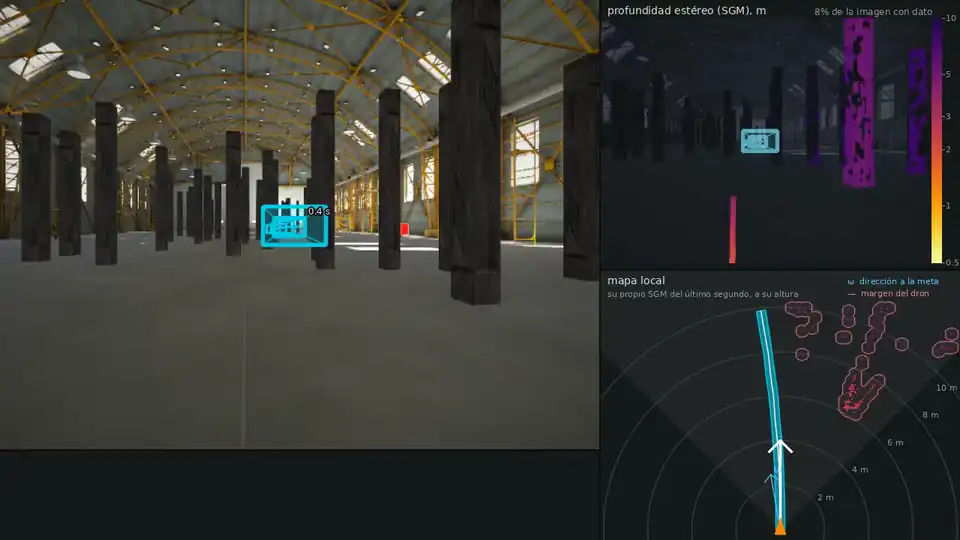

# tinyuav

Navegación rápida entre obstáculos y seguimiento de objetivos con percepción a bordo (estéreo + SGM),
políticas de ~0.4 M parámetros y evaluación en lazo cerrado en un simulador propio, en Flightmare (Unity)
y en Gazebo Harmonic / ROS 2 Jazzy.

<p align="center">
  <a href="docs/media/flightmare_warehouse_10ms.mp4">
    
  </a>
</p>

*Flightmare, almacén, 10 m/s. Política DiffPhys (R25), que no se entrenó en este entorno. Izquierda:
cámara del dron y trayectoria elegida (marcas a 0.4 s y 1.0 s). Derecha: profundidad SGM y mapa local
con el SGM del último segundo. [MP4](docs/media/flightmare_warehouse_10ms.mp4)*

## Resultados

| tarea | entorno | resultado | referencia |
|---|---|---|---|
| navegar 40 m a 3–10 m/s | bosque de R18, 120 vuelos | **111/120**; 29/30 a 10 m/s | Loquercio et al. 2021: ~60 % a 10 m/s¹ |
| navegar 40 m a 3–10 m/s | almacén de Flightmare, 120 vuelos | **117/120**, 2 choques | piloto reactivo (R24): 104/120 |
| seguir un globo a 3–7 m/s | bosque de 1/16 m⁻², 150 vuelos | **147/150**, 0 choques | YOPOv2-Tracker: 88 %¹ (Fisher p = 0.008) |
| latencia de la política | 1 hilo de CPU | **1.1 ms** por decisión | — |

¹ Simuladores distintos; densidad y velocidades como en cada paper. Montaje, IC y pruebas emparejadas en
[R25](docs/research/R25_diffphys.md) y [R26](docs/research/R26_diffphys_seguimiento.md).

## Método

- **Percepción:** par estéreo → SGM → profundidad inversa de 16 × 12 (mínimo por bloque, huecos como
  lejos, filtro de bordes `--edge`).
- **Política (R25):** CNN (32/64/128 filtros) + GRU de 192 → aceleración; entrada: profundidad, velocidad,
  empuje y velocidad deseada. Entrenada por gradiente a través de un simulador de masa puntual
  diferenciable (Zhang et al. 2025), sin experto ni etiquetas; vuelo previo sin gradiente (`--burn`).
- **Seguimiento (R26 + R20):** la misma red ajustada con una barrera de visibilidad dron → objetivo;
  detector de color, filtro de Kalman 3D, re-bloqueo y predicción del giro (`--fast-target`).
- **Bases:** recreación de Loquercio et al. 2021 (experto M-H, estudiante por DAgger, R18), piloto reactivo
  sin red (R24), puente ZMQ con Flightmare (R22) y Gazebo (R21). Antes, E0–R17: CNN monocular int8 + ToF 8×8
  para un ESP32-S3.

## Instalación

```bash
git clone https://github.com/an1nf/tinyuav.git && cd tinyuav
python -m venv .venv && source .venv/bin/activate
pip install -e ".[train,tflite,flightmare,dev]"     # CLI: nanouav
nanouav doctor
```

Entrenar en GPU Pascal (TITAN X): [docs/gpu.md](docs/gpu.md). Modelos, datos y resultados quedan fuera de
git: [docs/artefactos.md](docs/artefactos.md).

## Uso

```bash
nanouav list                                                   # experimentos registrados
nanouav run r25 train --burn 0,30                              # → results/r25/diffphys.keras (receta: R25)
nanouav run r18 eval --pilots diffphys --model results/r25/diffphys.keras --v 3,5,7,10 --n 30 --edge
nanouav run r26 train --init results/r25/diffphys.keras --name follow_fast.keras --v 1,7   # receta: R26
nanouav run r20 sim --pilots diffphys --model results/r26/follow_fast.keras \
    --density 0.0625 --speed 7 --n 30 --fast-target
nanouav run r25 bench --model results/r26/follow_fast.keras    # tiempo por decisión

export NANOUAV_FLIGHTMARE=/ruta/RPG_Flightmare.x86_64          # Flightmare
nanouav run r22 eval --arena --scene warehouse --pilots diffphys --model results/r25/diffphys.keras \
    --v 3,5,7,10 --n 30 --edge
nanouav run r22 follow-video --model results/r26/follow_fast.keras --speed 7 --fast-target
```

`nanouav run <id> --help` lista las opciones; las suites YAML, en [docs/experimentos.md](docs/experimentos.md).
Gazebo: [docs/gazebo.md](docs/gazebo.md).

## Estructura

```
src/nanouav/agile/       R18 (SGM, experto, DAgger), R25 diffphys.py, R26 diffphys_follow.py
src/nanouav/follow/      detección, tracker, filtro 3D y misiones de seguimiento (R19, R20)
src/nanouav/flightmare/  puente ZMQ, arenas y seguimiento en Flightmare (R22)
src/nanouav/…            simulador propio, percepción, planificación, control, experimentos
gazebo/ docker/          mundos, nodos ROS 2 e imágenes Docker
tests/                   pytest -m "not slow"
docs/research/           un informe por iteración (R1–R26)
```

## Licencia

Por definir.
